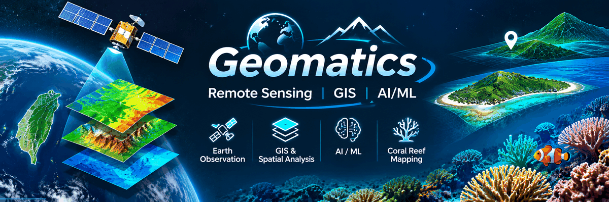

<!-- ====================================================== -->
<!-- SHIV SHANKAR PANDEY | GITHUB PROFILE README             -->
<!-- ====================================================== -->

<!-- GEOMATICS ANIMATED BANNER -->

<h1 align="center">Hi 👋, I'm Shiv Shankar Pandey</h1>

<h3 align="center">Geomatics Student | Remote Sensing | GIS | Data Science | AI/ML</h3>

<!-- CODING ANIMATION -->

## 👨‍🔬 About Me

- 🎓 Studying Geomatics and exploring geospatial technologies.
- 🛰️ Interested in Satellite Remote Sensing and Earth Observation.
- 🌍 Exploring GIS, Spatial Statistics and 3D Terrain Modelling.
- 🪸 Working on Coral Reef Mapping and Underwater Image Segmentation.
- 🤖 Interested in Machine Learning and AI for environmental applications.
- 📊 Experienced with Data Analytics and Data Visualization.
- 💻 Programming with Python, R and SQL.
- 📫 Email: **pandeyshivshankar03@gmail.com**

 

---

## 🌏 Geomatics | Remote Sensing | GIS

### Exploring Earth from Space to Seabed 🌍

*Combining Satellite Imagery, GIS, Spatial Analysis and Artificial Intelligence.*

### 🔬 Research Interests

| Field | Areas of Interest |
|---|---|
| 🛰️ Remote Sensing | Landsat, Sentinel-2, PlanetScope |
| 🌍 GIS & Geomatics | Spatial Analysis, Cartography, 3D GIS |
| 🪸 Marine Mapping | Coral Reef Mapping, Benthic Classification |
| 🤖 Artificial Intelligence | Machine Learning, Deep Learning |
| 🗺️ Spatial Statistics | Spatial Modelling, Geospatial Analysis |
| 🌊 Environmental Monitoring | Ocean Mapping, Habitat Monitoring |

---

## 🛠️ Languages and Technologies

### 💻 Programming & Data Science

### 🛰️ GIS & Remote Sensing

### 📊 Data Analytics & Visualization

---

## 🚀 Featured Projects & Research

- 🪸 **Coral Reef Mapping:** Geospatial analysis and coral habitat classification.
- 🌊 **Underwater Image Segmentation:** AI-based benthic image classification.
- 🛰️ **Satellite Image Analysis:** Remote sensing and spectral index analysis.
- 🌍 **GIS & Spatial Analysis:** Terrain modelling and spatial statistics.
- 📊 **Data Analytics:** Sales, transportation and environmental data analysis.
- 🤖 **Machine Learning:** Predictive modelling and statistical learning.

---

## 📊 GitHub Statistics

  

### 💻 GitHub Profile

- 👨‍💻 GitHub: [ShivShankar07-18](https://github.com/ShivShankar07-18)
- 📁 Explore my repositories and projects.
- 🌍 Interested in Geomatics, GIS, Remote Sensing and AI/ML.

---

## 🌐 Connect With Me

---

### 🌍 Mapping the Earth. Understanding the Data. Exploring the Future.

*From Satellite Imagery to AI-Powered Geospatial Intelligence.*

